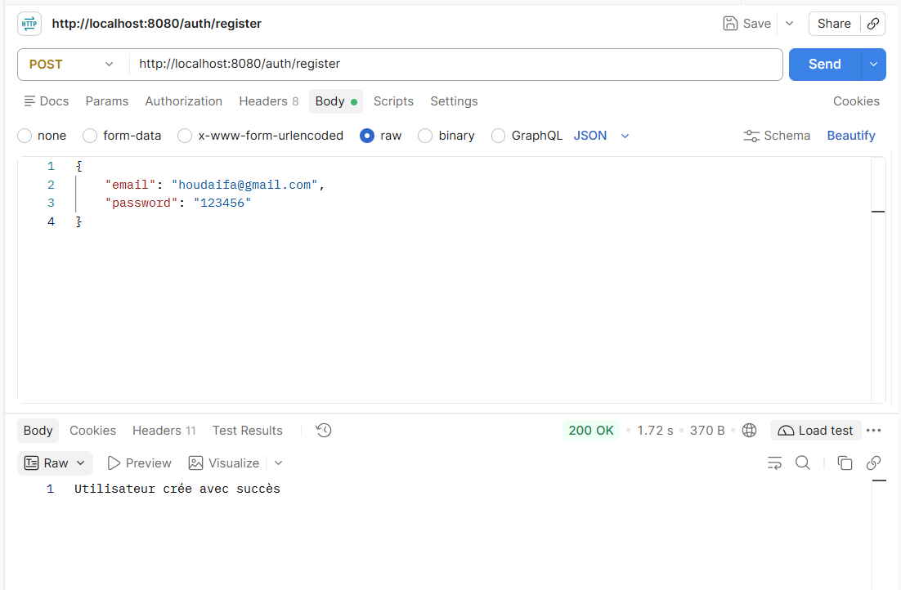
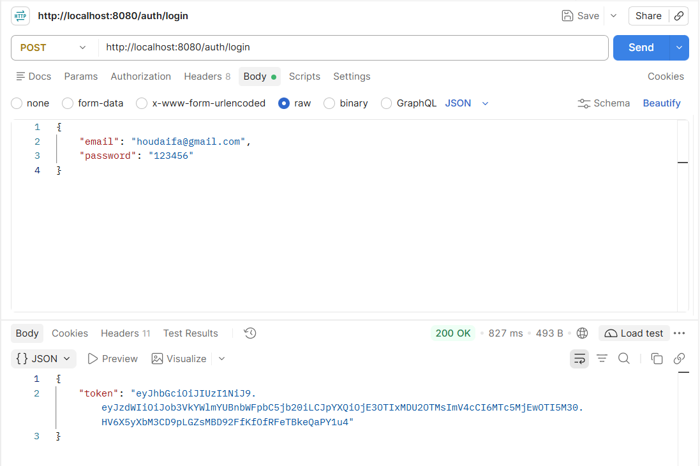
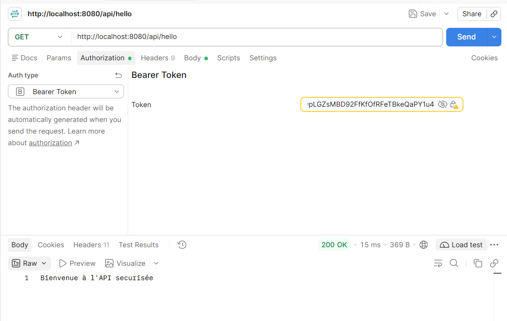
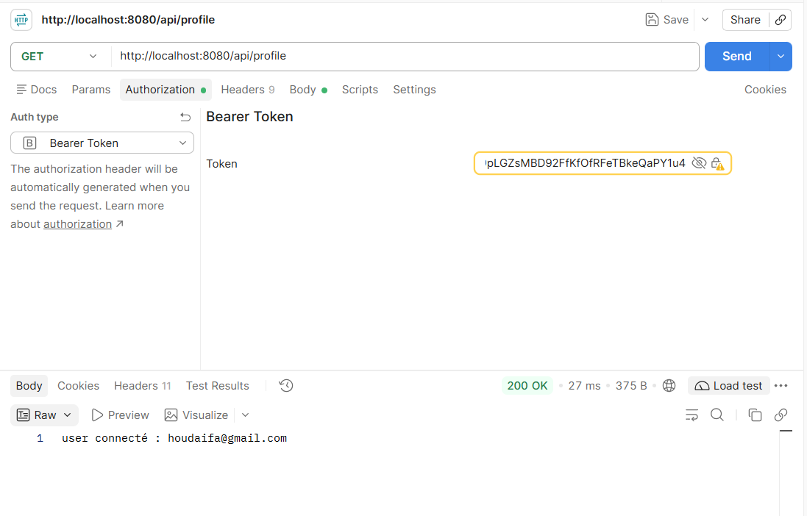

# TP_JWT

API REST Spring Boot sécurisée avec JWT. Les routes d'authentification permettent
de créer un compte et d'obtenir un jeton, ensuite utilisable sur les routes
protégées de l'API.

## Routes de l'API

| Méthode | Route | Accès | Description |
| --- | --- | --- | --- |
| `POST` | `/auth/register` | Public | Crée un utilisateur à partir d'un email et d'un mot de passe. |
| `POST` | `/auth/login` | Public | Authentifie l'utilisateur et renvoie un JWT. |
| `GET` | `/api/hello` | JWT requis | Renvoie un message de bienvenue. |
| `GET` | `/api/profile` | JWT requis | Renvoie l'identifiant de l'utilisateur connecté. |

Les requêtes d'inscription et de connexion attendent un corps JSON de la forme :

```json
{
  "email": "utilisateur@example.com",
  "password": "mot-de-passe"
}
```

Pour appeler `/api/hello` ou `/api/profile`, transmettre le jeton obtenu lors de
la connexion dans l'en-tête `Authorization` :

```text
Authorization: Bearer <jeton>
```

## Captures d'écran des tests des routes

### Inscription — `POST /auth/register`



### Connexion et récupération du JWT — `POST /auth/login`



### Route protégée — `GET /api/hello`



### Profil protégé — `GET /api/profile`




